

# 🧰 Padawan Suite

**Ta trousse d'outils Windows, 100 % locale, gratuite et en français.**
Une IA qui tourne sur ton PC, un archiveur de vidéos et de pages web, un journal de bord privé… derrière une seule petite icône.

*A free, local-first Windows toolkit in French: offline AI assistant (Ollama), video & web archiver, private journal. No account, no subscription.*

**[⬇️ Télécharger Padawan-Setup.exe](https://github.com/marcsevigny1971/padawan-suite/releases/latest)** · **[🌐 Présentation complète](https://marcsevigny1971.github.io/padawan-suite/)** · **[💡 Idées et suggestions](https://github.com/marcsevigny1971/padawan-suite/issues)**

Captures réelles des programmes, avec des données de démonstration.

---

## 🤔 Pourquoi Padawan ?

Parce qu'on n'a pas besoin d'un abonnement et d'un compte en ligne pour avoir de bons outils.

- 🔒 **Tes données restent chez toi.** L'IA tourne sur ton PC grâce à [Ollama](https://ollama.com/). Tes notes, ton journal et tes archives sont des fichiers sur ton disque, dans des formats ouverts (SQLite, JSON, MP4, HTML).
- ✈️ **Ça marche hors ligne.** Sans Internet, Padawan répond avec ses connaissances locales, et le Journal, le Grimoire et l'Arsenal fonctionnent normalement. Avec Internet, Padawan va en plus chercher des sources sur le web et les cite.
- 💸 **Gratuit, sans abonnement, sans pub.** Licence MIT, logiciels libres et légaux seulement.
- 📦 **Un seul installateur** (`Padawan-Setup.exe`), sans droits d'administrateur, sans compte, sans mot de passe à retenir.
- 🪶 **Une seule icône** près de l'horloge. Clic droit, et toute la suite est là, avec des lancements discrets et une seule instance par programme.
- 🇨🇦 **En français, fait au Québec**, avec l'aide (`F1`) et les guides `LISEZMOI` en français.

## ⭐ Les trois vedettes

### 🤖 Padawan IA : une IA locale qui développe ses réponses

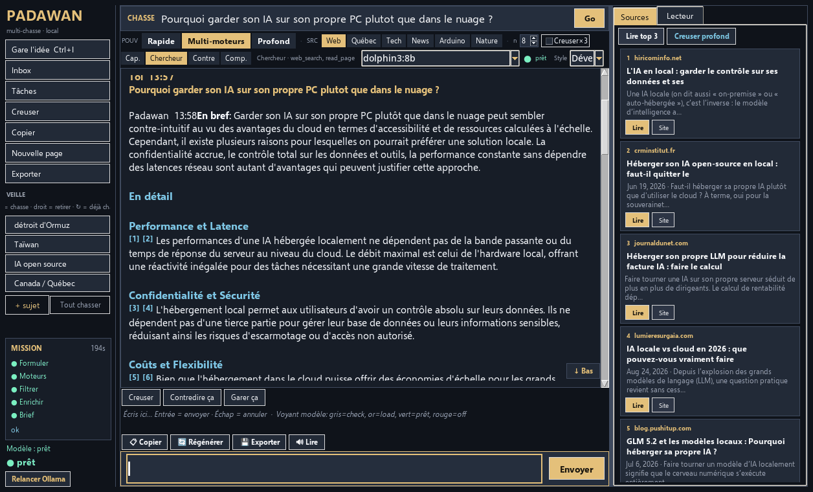

- Tourne sur **ton** PC avec Ollama. Le cerveau par défaut est **dolphin3:8b**, et tu peux choisir un autre modèle installé dans Ollama.
- Des réponses **développées** : en bref, des sections claires, « Mon take », puis **💡 Pour aller plus loin**. Le menu **Style** passe de *Court* à *Équilibré* ou *Développé*.
- **Recherche web multi-moteurs** quand tu es en ligne (Web, Québec, Tech, News, Arduino, Nature), avec les sources numérotées `[1]` `[2]` et un panneau pour les lire. Hors ligne, il répond avec ce qu'il sait.
- Copier, Régénérer, Exporter, et **Lire** à voix haute avec la voix de Windows.

La réponse sur la capture est une vraie réponse de dolphin3:8b à la question posée.

### 🎞️ Archiveur : garde une copie de ce que tu ne veux pas perdre

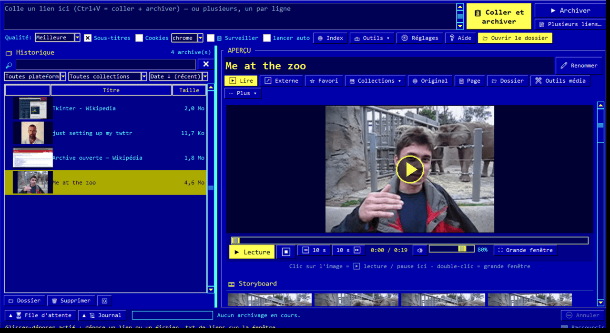

- Colle un lien (YouTube, X, Facebook, pages web…) : **« Coller et archiver »**, ou simplement `Ctrl+V`.
- Les vidéos sont gardées en **MP4 H.264 lisible partout**, avec la miniature, le texte du post et les sous-titres FR/EN. Le moteur est [yt-dlp](https://github.com/yt-dlp/yt-dlp), avec ffmpeg installé par le setup.
- **Lecteur intégré**, storyboard, extraits, captures, MP3 ou GIF. La **transcription horodatée** utilise les sous-titres, ou faster-whisper en local si tu l'installes (optionnel).
- **Pages web complètes** : une page HTML autonome, une capture et un PDF. Tu as aussi des favoris, des collections, la recherche, les doublons, la vérification des archives et l'export ZIP, CSV ou JSON.

### 📓 Journal de bord : le journal du capitaine (nouveau en v1.1)

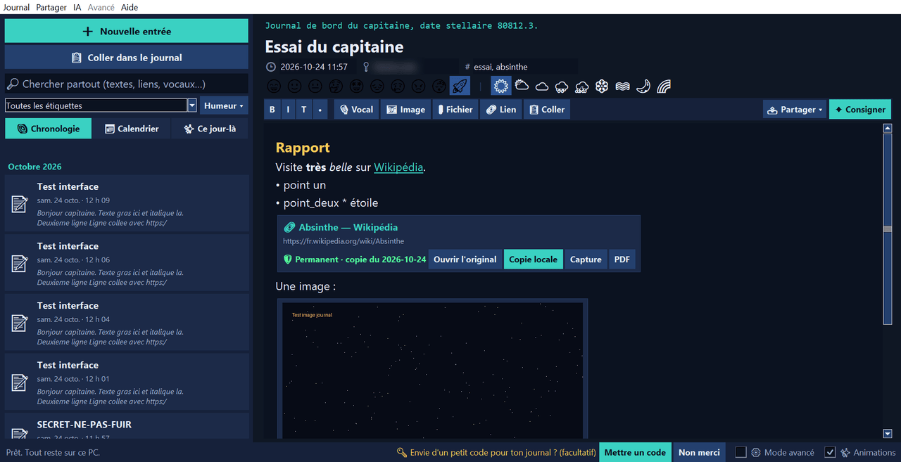

- **Privé par défaut.** `Ctrl+Alt+J` ouvre une nouvelle entrée de n'importe où, et `Ctrl+Alt+K` envoie ce que tu viens de copier dans l'entrée du jour.
- **Le copier-coller au cœur.** `Ctrl+V` de n'importe quoi (texte, lien, image, capture, fichier) devient la bonne pièce dans l'entrée.
- **Des liens permanents.** La page est copiée sur ton PC (copie locale, capture, PDF), et le lien d'origine reste à côté.
- **Des mémos vocaux**, des images, l'humeur, la météo, le lieu et des étiquettes.
- **Tout retrouver** avec la recherche éclair, la chronologie, le calendrier et « Ce jour-là ».
- **Partager seulement ce que tu choisis.** Une entrée ou un simple passage part en page HTML autonome, PDF, .zip ou texte. Les autres entrées ne suivent jamais.
- **Code facultatif** et **entrées scellées** (chiffrées) en mode avancé. `F11` passe en plein écran, avec des animations qu'on peut couper.

## 🖼️ Galerie

| | |
|---|---|
| 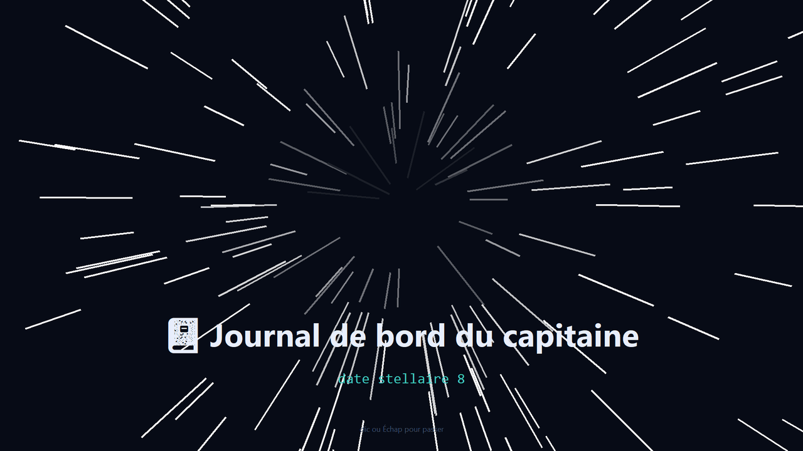 Journal : l'ouverture « hyperespace » | 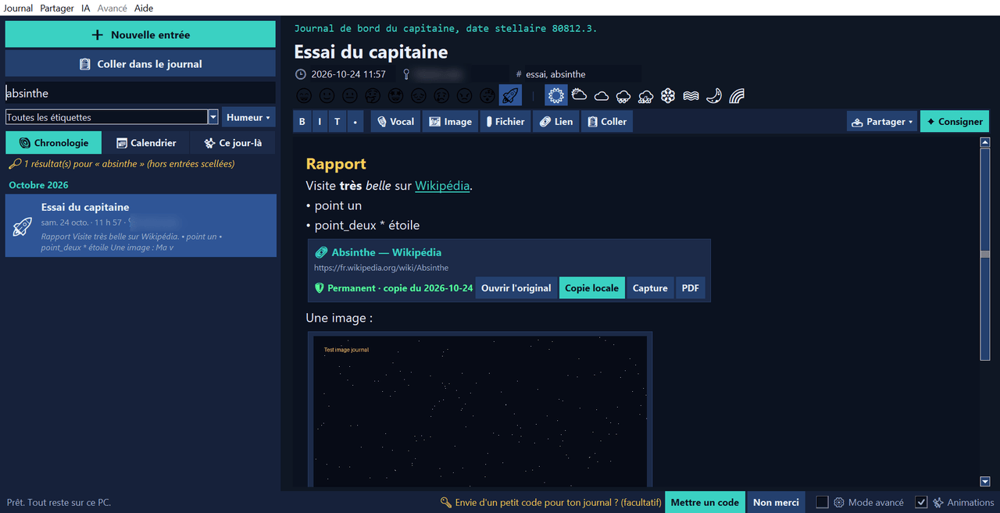 Journal : la recherche éclair |
| 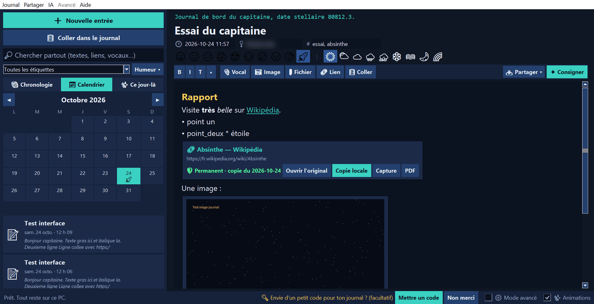 Journal : le calendrier | 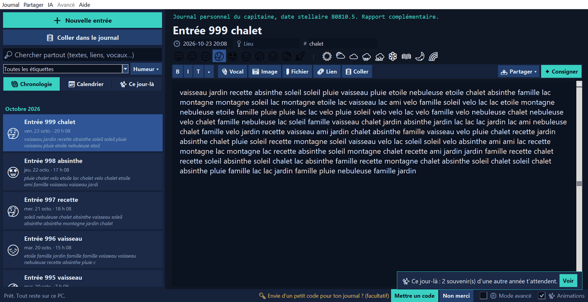 Journal : test avec 1 000 entrées, et « Ce jour-là » |
| 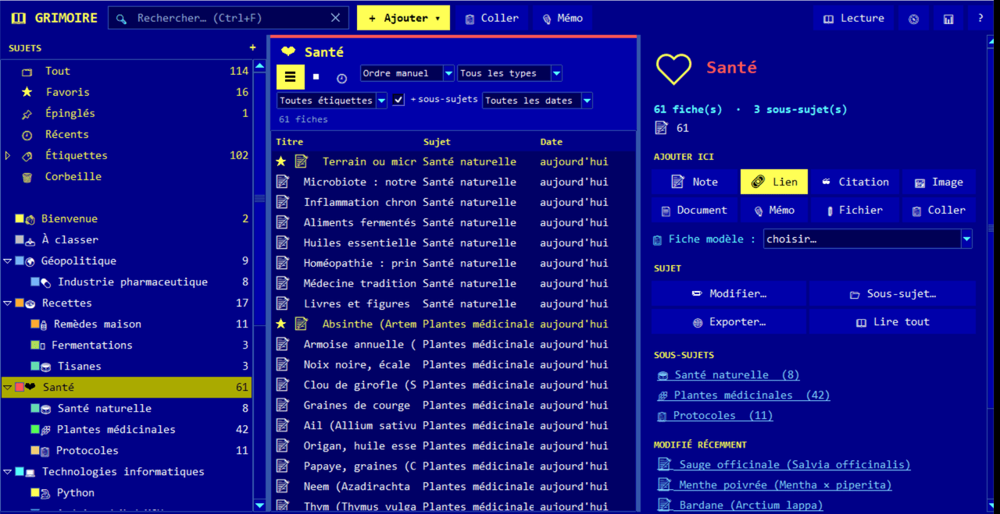 Grimoire : notes, liens et médias par sujets | 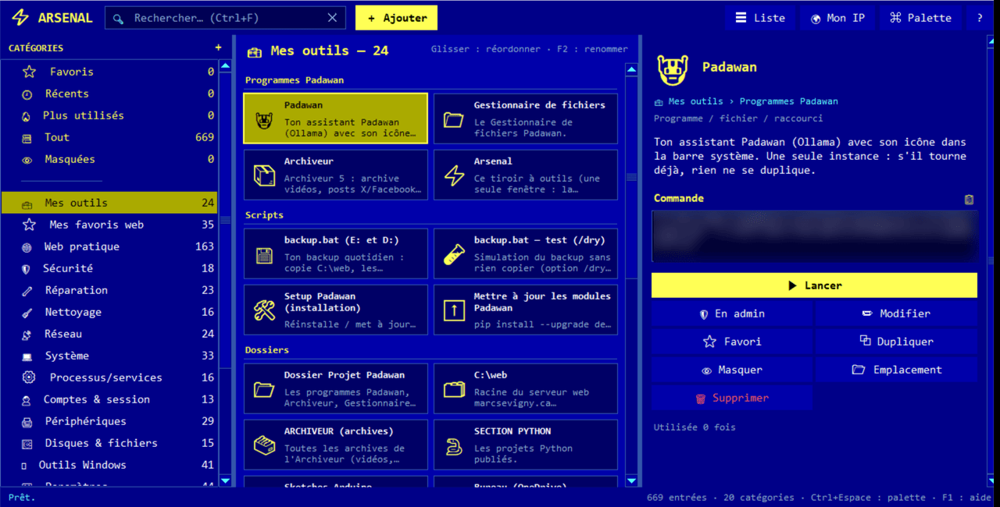 Arsenal : des centaines d'outils Windows à un clic |
| 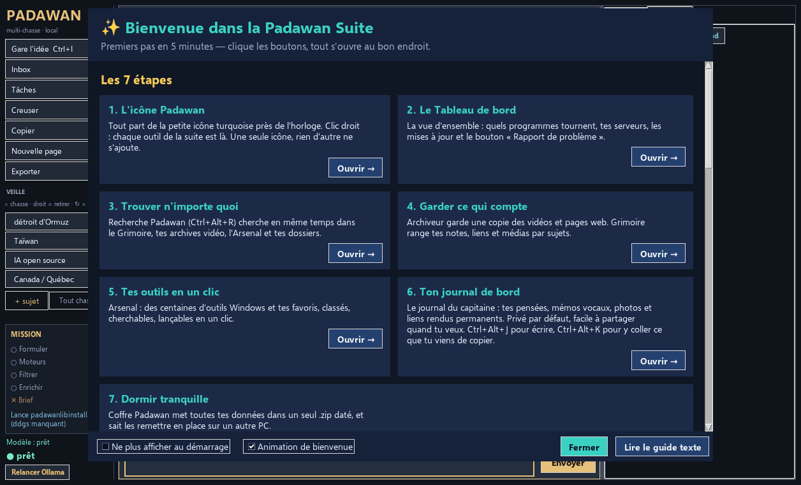 Premiers pas : le guide de 5 minutes | 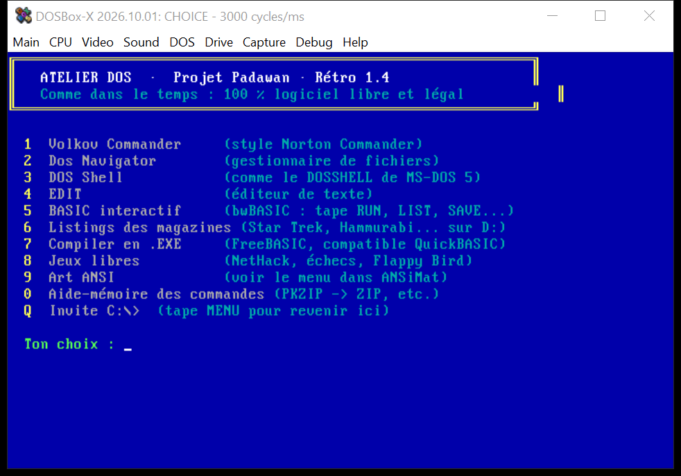 Rétro : l'Atelier DOS (logiciels libres) |

## ⚖️ Comparaison honnête

Padawan ne remplace pas tout. Voici où il se situe face à des outils connus.

| | **Padawan Suite** | ChatGPT (web) | Obsidian / Notion | 4K Video Downloader / yt-dlp seul |
|---|---|---|---|---|
| Où vont tes données | 🟢 Sur ton PC | 🟠 Sur les serveurs du service | 🟢 Obsidian : fichiers locaux · 🟠 Notion : dans le nuage | 🟢 Sur ton PC |
| Fonctionne sans Internet | 🟢 IA, notes, journal | 🔴 Non | 🟢 Obsidian · 🟠 Notion : limité | 🔴 Il faut Internet pour télécharger (normal) |
| Prix | 🟢 Gratuit (MIT) | 🟠 Gratuit avec limites, abonnements payants | 🟠 Gratuit pour l'usage perso, options payantes | 🟠 4K : gratuit avec limites · 🟢 yt-dlp : gratuit |
| Facilité | 🟢 Un installateur, une icône, en français | 🟢 Très simple | 🟠 Demande un peu d'apprentissage | 🟠 yt-dlp s'utilise en ligne de commande |
| Tout-en-un (IA + archives + notes + journal) | 🟢 Oui, et ça se parle | 🔴 IA seulement | 🔴 Notes seulement | 🔴 Vidéos seulement |
| Là où Padawan est moins bon | | Les gros modèles en ligne sont bien plus puissants qu'un modèle 8B local | Énorme écosystème de plugins, synchro et collaboration | yt-dlp seul est plus flexible (Padawan l'utilise d'ailleurs sous le capot) |

## ⬇️ Installer en 3 gestes

1. Va sur la page **[Releases](https://github.com/marcsevigny1971/padawan-suite/releases/latest)** et télécharge **`Padawan-Setup.exe`**.
2. Double-clique dessus.
   Windows peut afficher « Windows a protégé votre ordinateur ». C'est normal pour un petit logiciel fait maison qui n'est pas signé : clique **« Informations complémentaires »**, puis **« Exécuter quand même »**.
3. Laisse-toi guider. Python et ses modules s'installent tout seuls si besoin (quelques minutes sur un PC neuf). À la fin, l'icône Padawan apparaît près de l'horloge : **clic droit**, et tout est là.

- ✅ Aucun droit d'administrateur, aucun compte, aucun mot de passe.
- ✅ Windows 10 ou 11. 8 Go de mémoire suffisent (16 Go si tu veux l'IA locale bien à l'aise).
- 🗜️ Plan B : **`Padawan-Projet.zip`** (même contenu). Clic droit > « Extraire tout », puis double-clic sur `INSTALLER.bat`.
- 🔁 Mise à jour : réinstalle simplement la nouvelle version par-dessus. Tes données restent là.
- 🧹 Désinstaller : Paramètres > Applications > « Projet Padawan ». Tes données sont gardées.

## ✨ Nouveautés v1.2 : cartes, liens permanents et curseur vivant (31 octobre 2026)

- 📓 **Journal de bord 1.4** : la date normale dans le titre (la date stellaire devient une option), 4 thèmes (Papier, Nuit douce, Forêt + l'original), animations discrètes, modèles d'entrée, favoris, corbeille, impression et export, série de jours d'écriture. À l'ouverture, il sait quel jour on est : nouvelle entrée ou suite de ton quart de nuit, l'heure ajoutée dans le texte comme des notes au dossier, et un **curseur vivant** qui respire là où tu écris.
- 🔗 **Liens permanents** : chaque lien collé dans le Journal ou le Grimoire affiche un aperçu (image, site, titre). Le bouton **📦 Rendre permanent** le fait archiver par l'Archiveur, et la copie se joue directement dans l'entrée. Nouveau panneau **🔗 Mes liens**.
- 📚 **Grimoire 1.5** : les fiches en belles cartes avec images, une **carte des sujets** animée (F8), et le bouton **📚 Envoyer au Grimoire** dans l'Archiveur.
- 🎞️ **Archiveur** : conversion beaucoup plus rapide avec la carte graphique (NVENC / Quick Sync / Media Foundation, retour automatique au processeur), barre de progression vivante, **storyboard automatique** cliquable, et **collections** avec classement proposé en un clic (annulable).
- 🧭 **Tableau de bord et menu de l'icône** : outils les plus utilisés en haut, serveurs en bas, barre de défilement, et les fenêtres s'ouvrent agrandies.

## ✨ Nouveautés v1.1 : Journal de bord (24 octobre 2026)

- 📓 **Journal de bord** : le journal du capitaine, privé par défaut. `Ctrl+V` colle n'importe quoi (texte, lien, image, capture, fichier), `Ctrl+Alt+K` envoie ce que tu viens de copier dans l'entrée du jour, les liens deviennent permanents, les mémos vocaux se glissent dans les entrées, et tu partages seulement le passage que tu choisis.
- 🗣️ **Padawan plus vivant** : des réponses plus développées, en sections, qui finissent par **💡 Pour aller plus loin**. Nouveau cerveau par défaut : **dolphin3:8b**, et le menu **Style : Court / Équilibré / Développé**.
- 🔎 La Recherche Padawan trouve aussi tes entrées du journal, et le Tableau de bord, Premiers pas et le menu de l'icône connaissent le nouvel outil.

## 🧩 Ce qu'il y a dans la suite

| Outil | En deux mots |
|---|---|
| 🤖 **Padawan IA** | Un assistant vivant qui discute avec toi grâce à une IA installée sur ton PC (Ollama, dolphin3:8b par défaut). Réponses courtes, équilibrées ou développées, avec un « 💡 Pour aller plus loin ». Tes questions restent chez toi. |
| 🧭 **Tableau de bord** | La vue d'ensemble : ce qui tourne, les mises à jour et un bouton « Rapport de problème ». |
| 🚀 **Premiers pas** | Un guide de 5 minutes, avec des boutons qui ouvrent le bon outil au bon endroit. |
| 🔎 **Recherche Padawan** | `Ctrl+Alt+R` : cherche partout à la fois (Grimoire, archives, Arsenal, dossiers). |
| 🗄️ **Coffre Padawan** | Toutes tes données dans un seul .zip daté, et la remise en place sur un autre PC. |
| 🎞️ **Archiveur** | Garde une copie des vidéos et pages web (YouTube, X, Facebook…) en MP4 lisible partout. |
| 📓 **Journal de bord** | Ton journal de capitaine : texte, liens permanents, images, mémos vocaux, recherche éclair, « Ce jour-là », entrées scellées et partage d'un seul passage. `Ctrl+Alt+J` |
| 📚 **Grimoire** | Ton deuxième cerveau : notes, liens, PDF, images et mémos vocaux classés par sujets. |
| 🧰 **Arsenal** | Des centaines d'outils, commandes et raccourcis Windows, à un clic. |
| 🗂️ **Gestionnaire de fichiers** | Deux panneaux, tout au clavier, à la Norton Commander. |
| 💬 **Messager** | L'esprit MSN Messenger entre les gens qui ont la suite. Un pseudo, pas de mot de passe. |
| 📬 **Facteur** | Range tout seul les nouveaux fichiers (Téléchargements…) selon tes règles. Rien n'est effacé. |
| 🏗️ **Chantier** | Un petit serveur (web, base de données, FTP…) sur ton PC, seulement si tu le demandes. |
| 🕹️ **Rétro** | Commodore 64, MS-DOS et Windows 98, avec des jeux gratuits et légaux, et un atelier BASIC. |

Pour tout voir en détail, avec des exemples concrets : **[la présentation](https://marcsevigny1971.github.io/padawan-suite/)**.

## ❓ FAQ

**C'est vraiment gratuit ?**
Oui. Le code est sous licence MIT, sans pub, sans abonnement et sans compte. Les outils et jeux fournis sont libres et légaux.

**Est-ce qu'il faut Internet ?**
Pour installer, oui, et pour télécharger le modèle d'IA la première fois (dolphin3:8b pèse environ 5 Go). Ensuite, Padawan IA, le Journal, le Grimoire, l'Arsenal et le Gestionnaire marchent hors ligne. Archiver une vidéo, chercher sur le web ou utiliser le Messager demandent Internet, bien sûr.

**Dois-je installer Ollama moi-même ?**
Non. Si Ollama est absent, Padawan te demande la permission de l'installer, puis il télécharge le modèle.

**Mes questions à l'IA partent-elles quelque part ?**
Non : le modèle tourne sur ton PC. Seule la recherche web (quand tu es en ligne) envoie tes mots-clés aux moteurs de recherche, comme une recherche normale. Le Messager passe par un serveur, puisque c'est une messagerie.

**Pourquoi Windows affiche un avertissement à l'installation ?**
Parce que l'installateur n'est pas signé (un certificat coûte cher pour un projet gratuit). Le code est entièrement ici, tu peux le lire. Clique « Informations complémentaires », puis « Exécuter quand même ».

**Et sur Mac ou Linux ?**
Pas pour l'instant : la suite est pensée pour Windows 10 et 11.

**C'est en anglais aussi ?**
L'interface est en français pour l'instant. *The interface is French-only for now; contributions are welcome!*

**Comment je garde mes données en sécurité ?**
Le **Coffre Padawan** met tout dans un seul .zip daté, que tu peux remettre en place sur un autre PC.

## 📚 Ressources

- 🏠 Le projet : <https://github.com/marcsevigny1971/padawan-suite>
- 🌐 La présentation (GitHub Pages) : <https://marcsevigny1971.github.io/padawan-suite/>
- ⬆️ Les nouvelles versions : <https://github.com/marcsevigny1971/padawan-suite/releases>
- 💡 Une idée ou un petit souci ? <https://github.com/marcsevigny1971/padawan-suite/issues> (un compte GitHub gratuit suffit pour écrire)
- 🌐 Le site de Marc : <https://marcsevigny.ca/> (la suite est tout en bas, section Padawan)

Ces liens sont aussi dans la suite : clic droit sur l'icône Padawan > **📚 Ressources / GitHub**.

## 🗂️ Ce que contient ce dépôt

- `app/` : les programmes de la suite (Python + Tk), leurs icônes et leurs guides `LISEZMOI-*.txt`.
- `installer_padawan.ps1`, `INSTALLER.bat` : l'installation de secours (version .zip).
- `installer/padawan.iss` : le script Inno Setup qui fabrique `Padawan-Setup.exe`.
- `docs/` : la page de présentation, publiée avec GitHub Pages, et ses captures (`docs/img/`).

Les réglages personnels, les clés, les journaux et les pages de serveur ne sont pas dans ce dépôt. Chaque installation crée ses propres réglages sur son PC.

## 📄 Licence

Libre et gratuit, sous [licence MIT](LICENSE). Fait avec ❤️ au Québec par Marc Sévigny. *Que la Force soit avec ton PC* ✨

Si la suite t'est utile, une ⭐ sur GitHub aide d'autres personnes à la trouver. Merci !
